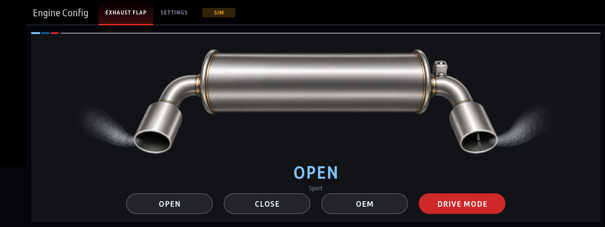
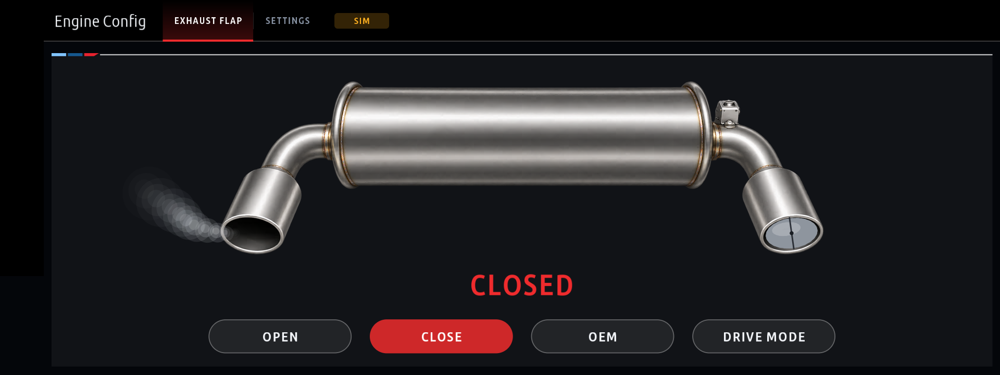
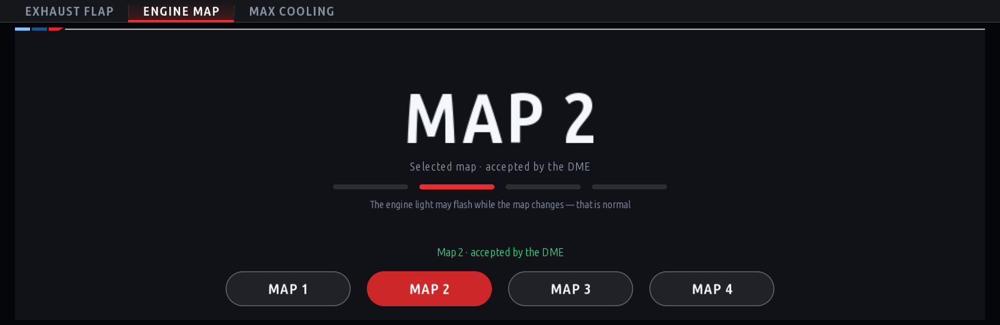
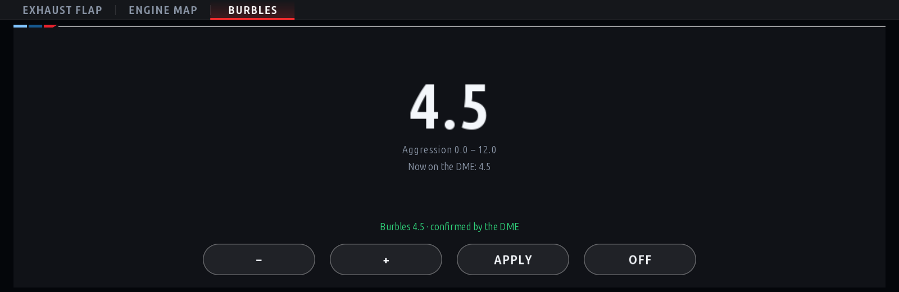
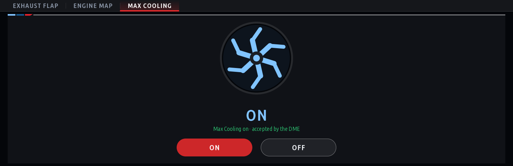

# bmw-idrive7-advokat

<p align="center">
  <b>Engine Config (<code>advokat_live_adjustments</code>) for the BMW MGU head unit (iDrive 7).</b><br>
  One app from <a href="https://github.com/cauliflowermossgrape/idrive7-apps">cauliflowermossgrape/idrive7-apps</a>,
  with the kit that builds and installs it, readable as a source by the
  <a href="https://github.com/robertnisipeanu/mgu-store">mgu Store</a>.
</p>

<p align="center">
  
</p>

## Disclaimer

Use at your own risk. These apps are not made or endorsed by BMW.

This is an unofficial hobby project, not affiliated with, endorsed by or supported by BMW AG. You modify your own head
unit at your own risk. Use the app parked or on a closed track, and keep your eyes on the road.

## What it does

Engine Config reaches the engine control unit (DME) over the car's own diagnostic link:

- **Exhaust flap:** OEM, Open and Close, or following the driving mode (Sport open, Eco Pro closed), held against the
  DME's timeout, with Close handed back above a set engine speed.
- **With BM3 or MHD picked in Settings:** engine map switching, burbles, ASD and Max Cooling.
- **Experimental:** xDrive off until the ignition cycle (behind its own setting), and a read-only xDrive live tab.

Its full description, settings and safety notes are in [apps/advokat_live_adjustments/README.md](apps/advokat_live_adjustments/README.md).

| | |
|---|---|
| <br>Flap closed, the selected mode in red | <br>Engine map 1 to 4 with one press (tuned DME) |
| <br>Burbles | <br>Max Cooling |

## Install from the mgu Store

Add this repository as a source in the Store on the car (Settings, Sources, `mlurker/bmw-idrive7-advokat`, pick a branch).
`mgu-repo.json` at the root makes it a *repo tree* source (see
[PUBLISHING.md](https://github.com/robertnisipeanu/mgu-store/blob/main/docs/PUBLISHING.md), section 3): the head unit builds
`apps/advokat_live_adjustments` from source. It lists no tools of its own, so nothing else is installed with it: the GPU renderer (`idrive7-renderd`) and the controller gate (`mgu-inputgate`) are expected to be on the car already, from the other apps' install.

BMW's SDK is not in this repository and is never published here: the head unit takes it from a stock BMW app already on it.

## Build and install it yourself

You need Python 3.6+ and Node.js 14+ on your PC, root shell access to the head unit (this project does not provide it),
and BMW's `oap-sdk` extracted from your own unit.

```sh
# 1. the SDK, from the x_call app that ships in the firmware
scp root@<unit>:'/usr/lib/oap-mainapp/preinstalled_apps/x_call@*.tgz' .
mkdir x_call && tar xzf x_call@*.tgz -C x_call
node kit/tools/extract_sdk.js x_call/javascript/app.js     # writes ./oap-sdk/

# 2. build the app -> dist/advokat_live_adjustments@<version>.mgu (contains BMW's SDK: keep it for your own car)
python3 kit/tools/build.py advokat_live_adjustments

# 3. pack the kit (app, installer, GPU renderer) -> dist/mgu-custom-apps.tar.gz
deploy/make-car-kit.sh              # Windows: deploy\make-car-kit.cmd

# 4. install; car parked, ignition on, ideally on a charger
HU=root@<unit-ip> PORT=22 KEY=~/.ssh/id_mgu deploy/push-to-car.sh check     # read-only
HU=root@<unit-ip> PORT=22 KEY=~/.ssh/id_mgu deploy/push-to-car.sh install   # backup, install, restart the app platform
HU=root@<unit-ip> PORT=22 KEY=~/.ssh/id_mgu deploy/push-to-car.sh restore   # back to the backup
```

`deploy/push-to-car.ps1` does the same on Windows. On the unit, `sh deploy-car.sh status | backups | restore`
(in `/var/opt/mgu-custom-apps`) shows what is installed and puts the car back to stock.

Try it on your computer without a car: `node kit/tools/emu.js advokat_live_adjustments` ([docs/emulator.md](docs/emulator.md)).
The tests that need no car: `node kit/tools/test_live_adjustments.js` and the others in `kit/tools/test_*`.

## Layout

```
apps/advokat_live_adjustments/   the app: app.json, main.js and its modules
kit/runtime/             the app runtime (platform glue, drawing, signals, diagnostics over TASU)
kit/renderd/             mgu-renderd, the GPU renderer, and the controller gate (prebuilt/ = ready binaries)
kit/tools/               build.py, make_kit.py, preview.js, emu.js, extract_sdk.js, tests
kit/emu/                 the live emulator's page and its WebAssembly draw engine
deploy/                  make-car-kit, push-to-car, the installer that runs on the unit
docs/                    RHMI widget reference, the emulator guide, screenshots
mgu-repo.json            what the mgu Store reads (repo tree layout)
```

## Credits and licence

This is a cut-down copy of [cauliflowermossgrape/idrive7-apps](https://github.com/cauliflowermossgrape/idrive7-apps)
(MIT, see [LICENSE](LICENSE)): all its other apps are removed here, and the original has them. The GPU renderer
`kit/renderd` is [mgu-render](https://github.com/robertnisipeanu/mgu-store) by Robert Nisipeanu and IterioDev,
GPL-3.0-or-later (`kit/renderd/LICENSE`); the controller gate in `kit/renderd/inputgate` is MIT. The emulator's build of
its draw engine (`kit/emu/wasm`, `kit/emu/web/gfx`) contains that code, so it is GPL-3.0-or-later too.
